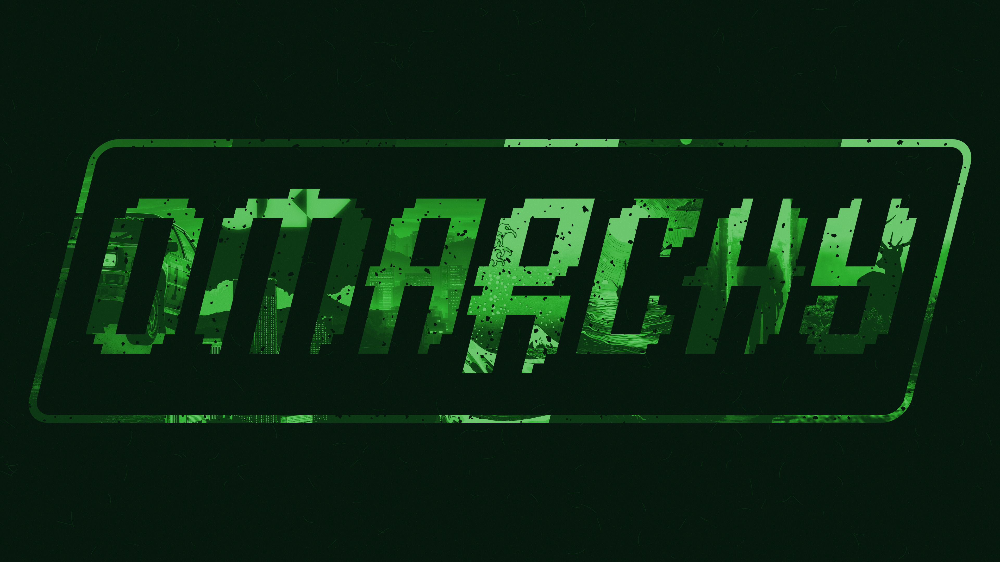
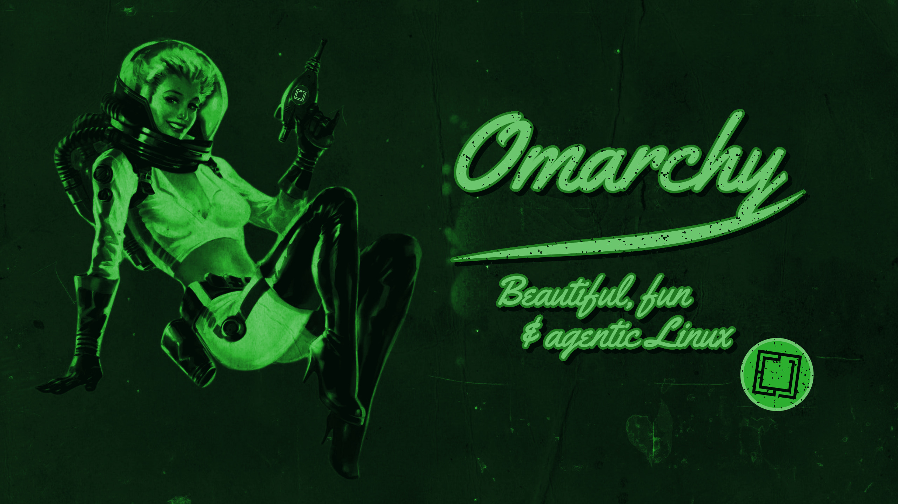

# Dark Terminal Protocol

A dark Omarchy theme inspired by the RobCo terminals and Pip-Boy of the Fallout series: phosphor green on near-black, CRT scanlines, Vault Boy, and the Omarchy mark flying Vault-Tec wings.

   


The theme on its own, with Omarchy's bar: Neovim, btop, eza and Files, all on solid phosphor-green windows. The Vault-Tec bar, the Pip-Boy menu and the status panels come with the [Terminal Protocol Controller](https://github.com/Anerti/terminal-protocol-controller).

## Wallpaper Gallery

This theme includes four wallpapers.

| Preview | Artwork |
| ------- | ------- |
|  | Omarchy, the winged mark on black: "The malleable OS for the age of agents" |
|  | Welcome Home: Vault Boy giving a thumbs-up |
|  | The Omarchy wordmark as the Fallout 4 title card, with an Omarchy theme wallpaper showing through each letter |
|  | The Nuka-Cola space pin-up, rebranded: "Omarchy: Beautiful, fun & agentic Linux" |

## Color Palette


## Components

- Alacritty
- btop
- Chromium
- Foot
- Ghostty
- GTK 4 / libadwaita apps such as Files (one-time link, see below)
- Hyprland (square corners, green glow, solid windows: working copy only, see below)
- Kitty
- Neovim
- Omarchy Shell (bar, lock screen, notifications, launcher, on-screen display, polkit, wallpaper picker)
- VS Code
- Shell plugins, from the [Terminal Protocol Controller](https://github.com/Anerti/terminal-protocol-controller): Pip-Boy menu, Omarchy terminal lock screen (with the PLEASE STAND BY hand-off), Vault-Tec workspaces wedge, and Vault Boy status panels (network, Bluetooth, audio, display, power, clock, weather, agents)
- From the controller too: VaultTec mouse cursors, the CRT effect (scanlines and vignette as a Hyprland screen shader), and the Omarchy terminal boot screen (passphrase prompt, then Vault Boy and INITIALIZING SYSTEM)

## Installation

Install it like any Omarchy theme. This clones it into `~/.config/omarchy/themes/dark-terminal-protocol` and applies it:

```bash
omarchy theme install https://github.com/Anerti/omarchy-dark-terminal-protocol-theme.git
```

Omarchy rebuilds an installed theme's Lua and terminal files from `colors.toml`, so the colors match everywhere, but the square corners, green glow and solid windows from `hyprland.lua` need a working copy instead:

```bash
git clone https://github.com/Anerti/omarchy-dark-terminal-protocol-theme.git ~/Work/dark-terminal-protocol
ln -s ~/Work/dark-terminal-protocol ~/.config/omarchy/themes/dark-terminal-protocol
omarchy theme set dark-terminal-protocol
```

GTK 4 apps read only one stylesheet, so they need a one-time link to the current theme's. Themes without a `gtk.css` leave it dangling, which GTK ignores:

```bash
ln -sf ~/.local/state/omarchy/current/theme/gtk.css ~/.config/gtk-4.0/gtk.css
```

### Vault-Tec extras

The shell plugins, cursors, CRT effect and boot screen ship with the [Terminal Protocol Controller](https://github.com/Anerti/terminal-protocol-controller) plugin:

```bash
omarchy plugin add https://github.com/Anerti/terminal-protocol-controller.git --enable
```

It adds a radiation icon to the bar with one switch per part, and its README lists the commands behind each switch.
