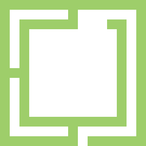
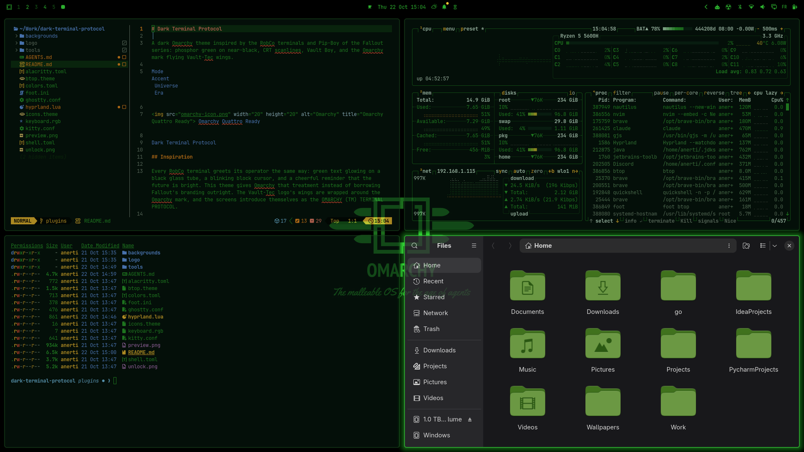
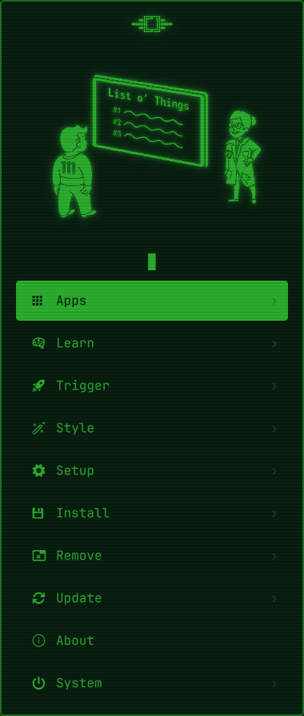
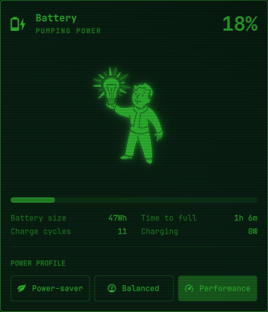
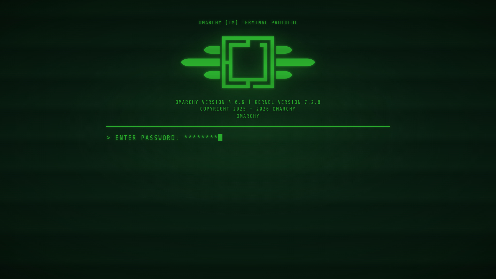
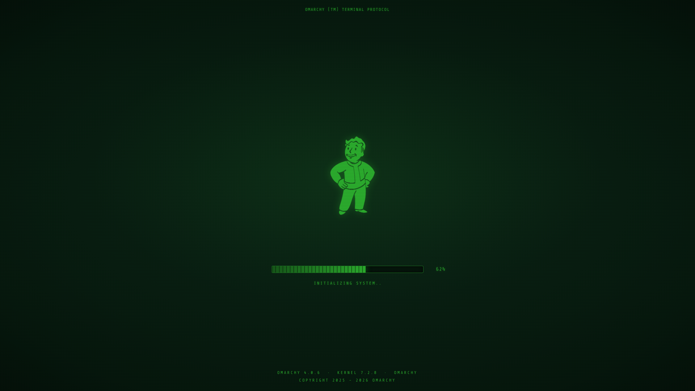
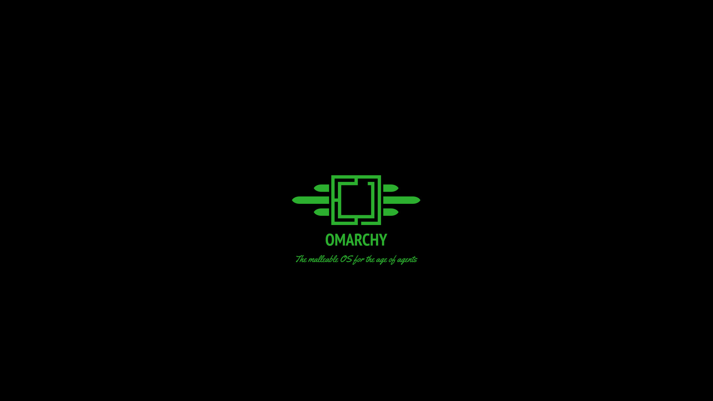

# Dark Terminal Protocol

A dark Omarchy theme inspired by the RobCo terminals and Pip-Boy of the Fallout series: phosphor green on near-black, CRT scanlines, Vault Boy, and the Omarchy mark flying Vault-Tec wings.

   

 



## Inspiration

Every RobCo terminal greets its operator the same way: green text glowing on a black glass tube, a blinking block cursor, and a cheerful reminder that the future is bright. This theme gives Omarchy that treatment instead of borrowing Fallout's branding outright. The Vault-Tec logo's wings are wrapped around the Omarchy mark, and the screens introduce themselves as the OMARCHY (TM) TERMINAL PROTOCOL.

The palette is built around a single phosphor green on near-black, with Vault-Tec yellow as the accent, so the desktop reads like one terminal rather than a collection of apps. Text is set in Share Tech Mono, spaced wide, with a soft green glow and scanlines.

The bar puts a Vault-Tec wedge in the centre: the winged Omarchy mark, with the workspaces either side of it. Click it to open the Pip-Boy menu. The other widgets sit to the left and right, and each opens a status panel with its own Vault Boy.

### Menu and panels

The Pip-Boy menu (**Super + Space**) looks and works like Omarchy's own menu, with the Vault-Tec logo and an animated Vault Boy for the section you are in at the top.



Each status panel (network, Bluetooth, audio, display, power, clock, weather, agents) keeps Omarchy's controls and adds a Vault Boy on a scanlined screen. This is the power panel:



### Lock and boot

The lock screen and the boot screen look the same: the winged mark, OMARCHY over BEAUTIFUL, FUN & AGENTIC LINUX, and a terminal-style password field. The footer shows the Omarchy version, kernel and hostname. Once the password checks out, the lock screen shows a PLEASE STAND BY test card, and the boot screen shows Vault Boy over an INITIALIZING SYSTEM progress bar.


| Boot: passphrase | Boot: initializing |
| ---------------- | ------------------ |
|  |  |

## Wallpaper Gallery

This theme includes two wallpapers.

| Preview | Artwork |
| ------- | ------- |
|  | Omarchy, the winged mark on black: "The malleable OS for the age of agents" |
|  | Welcome Home: Vault Boy giving a thumbs-up |

## Color Palette


## Components

- Alacritty
- btop
- Chromium
- Foot
- Ghostty
- Hyprland (4px radius, green glow, optional CRT shader)
- Kitty
- Neovim
- Omarchy Shell (bar, lock screen, notifications, launcher, on-screen display, polkit, wallpaper picker)
- Plymouth: the Omarchy terminal boot screen (passphrase prompt, then Vault Boy and INITIALIZING SYSTEM)
- VS Code
- Shell plugins: Pip-Boy menu, Omarchy terminal lock screen (with the PLEASE STAND BY hand-off), Vault-Tec workspaces wedge, and Vault Boy status panels (network, Bluetooth, audio, display, power, clock, weather, agents)
- VaultTec mouse cursors
- CRT effect: scanlines and vignette as an optional Hyprland screen shader

## Installation

Clone the repository into your Omarchy themes directory and set it:

```bash
git clone <repo-url> ~/.config/omarchy/themes/dark-terminal-protocol
cd ~/.config/omarchy/themes/dark-terminal-protocol
omarchy theme set dark-terminal-protocol
```

A theme cloned there counts as your own, so its `hyprland.lua` and terminal configs are applied. A theme installed with `omarchy-theme-install` has them stripped. Edits to the theme files apply only when `omarchy theme set` runs again.

The commands below run from the repository folder.

### Full theme

The colours are only part of it. `full-theme.sh` sets the theme and the cursors, then asks, one yes/no question each, whether to use the Vault-Tec version or Omarchy's built-in one of:

- **Menu**: the Pip-Boy menu.
- **Bar**: the Vault-Tec workspaces wedge and every Vault Boy status panel. The wedge sits alone in the centre and the widgets that were there move to the left. Built-in puts the Omarchy menu and workspaces back on the left and the rest in the centre. Widgets keep their settings either way.
- **Login**: the Omarchy terminal boot screen (asks for sudo and rebuilds the initramfs) and lock screen.

and whether to turn on the **CRT effect** (scanlines and vignette as a screen shader).

Nothing changes until you confirm the summary. Built-in disables the plugins, which stay installed so switching back is quick, and returns the boot screen to Omarchy's own. Run it again at any time to change your choices. It signs off by drawing the winged Omarchy logo in the terminal.

```bash
./full-theme.sh            # ask, then apply
./full-theme.sh --status   # show what is in use
./full-theme.sh --unset    # back to Omarchy's menu, bar, boot and lock screens, CRT off
```

`--unset` disables every Vault-Tec plugin, turns off the CRT effect, returns the boot screen to the one that was default before, makes sure each built-in they replaced is enabled again, then checks every part and reports it. The plugins stay installed, and the theme and cursors are left as they are.

### Individual parts

| Part | Command | Notes |
| ---- | ------- | ----- |
| Shell plugins | `bin/vault-tec-plugins [install\|uninstall] [id...]` | Copies `plugins/` into `~/.config/omarchy/plugins/` and restarts the shell. A plugin is enabled only on its first install. |
| Cursors | `bin/vault-tec-cursor [install\|uninstall]` | Installs `~/.local/share/icons/VaultTec` and a hook that uses it while this theme is active. |
| CRT effect | `bin/vault-tec-crt [on\|off\|toggle\|status]` | Scanlines and vignette as a Hyprland screen shader. It also shows in screenshots and recordings. |
| Boot screen | `bin/vault-tec-plymouth [install\|uninstall\|test]` | Installs the `vault-tec` Plymouth theme (sudo) and rebuilds the initramfs. Its footer shows the Omarchy version, kernel and hostname, and is redrawn whenever the initramfs is rebuilt, including after Omarchy upgrades and kernel installs. Reinstalling only rewrites what changed, and `uninstall` restores the boot screen that was default before. `test` plays it from a text console (Ctrl+Alt+F3); its passphrase is `omarchy`. |

Keybindings stay Omarchy's: **Super + Space** opens the Pip-Boy menu (also the wedge in the bar), **Super + Ctrl + Space** the background switcher.
